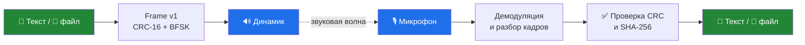

<div align="center">

# 🎧 SilentNetwork

### Связь через звук: динамик → воздух → микрофон

**Без Wi-Fi. Без Bluetooth. Без интернета. Без сотовой сети.**

[](docs/current-milestone.md)
[](acoustic-lab/)
[](apps/android/)
[](#тесты)
[](#чего-пока-нет)

</div>

---

## Что это

SilentNetwork — исследовательский проект автономной акустической связи.
Данные передаются звуковой волной от динамика к микрофону: текст и файлы
кодируются в BFSK-сигнал, проходят через воздух и декодируются на принимающей
стороне.

Это не «ещё один мессенджер». Это попытка построить физический канал связи там,
где радио запрещено, недоступно или нежелательно, — и честно измерить, что из
этого получается.



**Ключевой принцип:** интернет, Wi-Fi, Bluetooth и сотовая связь не
используются как транспорт данных и не являются резервным каналом. Если звук не
дошёл — данные не дошли.

---

## Честный статус

> **Это рабочий исследовательский прототип, а не готовая система связи.**
> Mesh-сеть не реализована. Rust Core, SCNP, шифрование и аутентификация ещё не
> написаны. Передача через воздух подтверждена только первым файловым контактом
> Laptop → Phone; серия измерений не проведена.

| Компонент | Состояние | Что это значит |
|---|---|---|
| BFSK-модулятор и демодулятор | ✅ Работает | Python и Kotlin, файловые и потоковые тесты |
| Frame v1 + CRC-16/CCITT-FALSE | ✅ Работает | Формат зафиксирован в ADR-001 |
| Передача текста (до 64 байт) | ✅ Работает | Windows ↔ Android, WAV и непрерывный чат |
| Передача файла (до 8192 байт) | ✅ Работает | Пакеты MANIFEST/DATA/END, SHA-256 |
| Windows Desktop Lab | ✅ Работает | WAV, PLAY, запись, анализ, чат |
| Android Audio Lab + Messenger | ✅ Работает | Запись, декодирование, чат, экспорт |
| ART/1 — надёжная доставка | 🧪 Python-прототип | ACK/retry/окна есть в Python, на Android не портировано |
| Rust Core / SCNP | ⛔ Не реализовано | Только контракты и планы |
| Шифрование и аутентификация | ⛔ Не реализовано | CRC и SHA-256 — не замена AEAD |
| Mesh / Discovery / Routing | ⛔ Не реализовано | Следующий большой этап |

Подробный статус задач — в [`TASK_BOARD.md`](TASK_BOARD.md), текущая цель — в
[`docs/current-milestone.md`](docs/current-milestone.md).

---

## Как это устроено

### Кадр и модуляция

Один кадр Frame v1 содержит преамбулу, служебные поля, payload и CRC-16.
Payload ограничен **64 байтами** — это осознанное ограничение первого модема,
а не временная заглушка.

| Профиль | Частоты (mark / space) | Символьная скорость | Где используется |
|---|---|---|---|
| `data-audible` | 1200 / 2200 Гц | 300 бод | Windows, основной |
| `data-robust` | 1000 / 2000 Гц | 100 бод | Windows, помехоустойчивый |
| `chat-normal` | 1200 / 2200 Гц | 300 бод | Android |
| `chat-excellent` | 1000 / 2000 Гц | 150 бод | Android |
| `chat-highfreq` | 16000 / 17500 Гц | 100 бод | Android, экспериментальный |

> Частоты 16–22 кГц — **экспериментальный диапазон**, а не гарантия
> неслышимости или поддержки конкретным устройством.

### Файловый слой

Файл до 8192 байт разбивается на пакеты `MANIFEST` / `DATA` / `END`,
передаётся кадрами Frame v1 и собирается обратно. Файл создаётся только при
полном наборе чанков и совпадении SHA-256. Это защита от случайных повреждений,
а не от злоумышленника.

### Непрерывный чат

Windows Desktop Lab и Android Messenger постоянно слушают микрофон. Отправка
текста или файла сразу запускает звук — отдельных шагов «создать WAV» и
«подтвердить PLAY» нет. Приём идёт потоково, по скользящему PCM-буферу.

Чат **полудуплексный**: пока одна сторона передаёт, она не принимает. ACK,
шифрования и аутентификации в чате нет.

---

## Демо

Проект состоит из двух приложений и одной лаборатории:

| | Windows Desktop Lab | Android Messenger |
|---|---|---|
| Передача текста | ✅ | ✅ |
| Приём текста | ✅ | ✅ |
| Передача файла | ✅ | ✅ |
| Приём файла | ✅ | ✅ |
| Непрерывный чат | ✅ | ✅ |
| Ручной анализ WAV | ✅ | ✅ |

Windows-приложение — Tkinter + NumPy/SciPy. Android-приложение — Kotlin,
`minSdk 26`, Material UI, без собственной DSP-реализации в UI-слое.

---

## Быстрый старт

### Windows: Python-лаборатория

Требуется Python 3.12 (проверено на 3.12.10, Windows 10/11).

```powershell
cd acoustic-lab
python -m venv .venv
.venv\Scripts\Activate.ps1
python -m pip install -r requirements.txt -r requirements-desktop.txt
python desktop_app.py
```

Отдельные CLI-инструменты:

```powershell
python scanner.py          # скан устройств и фона
python transmitter.py      # BFSK-передатчик
python receiver.py         # BFSK-приёмник
python file_transfer.py    # файловый слой v0
python benchmark.py        # BER/PER на AWGN
```

### Windows: готовая сборка

```powershell
dist\SilentNetwork-Desktop.exe
dist\SilentNetwork-Desktop.exe --smoke-test   # без открытия окна
```

EXE собирается локально через PyInstaller (onefile, 66 МБ), не подписан
сертификатом и не входит в Git.

### Android

```powershell
cd apps\android
.\gradlew.bat assembleDebug
adb install -r app\build\outputs\apk\debug\app-debug.apk
```

APK подписан debug-ключом. Для работы нужны разрешения на запись и
воспроизведение аудио.

### Файл через звук из CLI

```powershell
cd acoustic-lab
python file_transfer.py send --file note.txt --out results\note.wav
python file_transfer.py receive --wav results\note.wav --out-dir results\received
```

`send` создаёт WAV и отчёт `.tx.json`, `receive` — файл и отчёт `.rx.json`.
Это файловый канал L0: воспроизведение в динамик и запись микрофона выполняются
отдельно и не считаются доказанной передачей через воздух.

---

## Тесты

Все цифры ниже получены реальным запуском, а не оценены «на глаз».

| Набор | Команда | Результат |
|---|---|---|
| Python | `cd acoustic-lab; python -m pytest -q` | **777 passed** за 154.68 с |
| Android | `cd apps\android; .\gradlew.bat testDebugUnitTest testReleaseUnitTest` | **216 tests**, 2 skipped, 0 failures |
| Python ↔ Kotlin | `python acoustic-lab\cross_check_android.py` | **8/8** кейсов в обе стороны |

Что покрыто:

- конфигурация профилей, WAV I/O, метрики, AWGN, BER/PER;
- BFSK-модулятор и демодулятор на детерминированных векторах;
- файловый слой: потеря, повтор и конфликт чанков, SHA-256;
- потоковый разбор Frame v1 и чат-сессия;
- Android: кодек, профили чата, round-trip, негативные сценарии;
- кросс-проверка Python ↔ Kotlin на одинаковых WAV (текст, кириллица,
  бинарный файл, пустой файл).

> В тестах аудиобэкенд подменяется фейком. Реальный микрофон и динамик тестами
> не открываются. JVM- и файловые тесты **не доказывают** передачу через воздух.

---

## Структура репозитория

```text
SilentNetwork/
├── acoustic-lab/            # Python: DSP, BFSK, файлы, чат, бенчмарки
│   ├── snlab/               # профили, кадры, модуляция, приём, ART/1
│   ├── tests/               # pytest
│   ├── desktop_app.py       # Windows Desktop Lab
│   ├── scanner.py           # скан устройств и фона
│   ├── transmitter.py       # BFSK-передатчик
│   ├── receiver.py          # BFSK-приёмник
│   ├── file_transfer.py     # файловый слой v0
│   └── benchmark.py         # BER/PER на AWGN
├── apps/android/            # Kotlin: Audio Lab и Messenger
│   └── app/src/main/java/org/silentnetwork/app/
│       ├── audiolab/datalink/   # Frame v1, BFSK, кодеки
│       ├── audiolab/chat/       # непрерывный чат
│       ├── audiolab/audio/      # AudioRecord / AudioTrack
│       └── ui/                  # Audio Lab, Messenger, статус
├── docs/
│   ├── decisions/           # ADR-001: Frame v1 и BFSK
│   ├── current-milestone.md # цель M0 и критерии приёмки
│   ├── acoustic-chat.md     # контракт чата
│   ├── acoustic-file-transfer.md
│   ├── sn028-*.md           # протоколы физических измерений
│   └── reference/           # исходная архитектура v1.0
├── TASK_BOARD.md            # единый статус работ
└── AGENTS.md                # правила инженерного агента
```

---

## Дорожная карта

- [x] BFSK-тракт: модулятор, демодулятор, CRC-16
- [x] Frame v1 и профили передачи
- [x] Windows Desktop Lab и Android Audio Lab
- [x] Файловый слой до 8192 байт
- [x] Непрерывный чат Windows ↔ Android
- [x] ART/1 в Python (ACK, retry, окна)
- [ ] Серия реальных измерений Laptop → Phone и Phone → Laptop
- [ ] ART/1 на Android
- [ ] Rust Core и SCNP
- [ ] Шифрование и аутентификация (AEAD)
- [ ] Discovery и mesh-маршрутизация
- [ ] Store-and-Forward и Relay

Mesh — не «почти готово». Это отдельный большой этап, который начнётся только
после подтверждения базового акустического канала измерениями.

---

## Чего пока нет

Чтобы не было ложных ожиданий:

- ❌ **Mesh-сети нет.** Нет discovery, маршрутов, relay и store-and-forward.
- ❌ **Rust Core нет.** Есть только контракты и планы.
- ❌ **SCNP нет.** Wire-формат не реализован.
- ❌ **Шифрования нет.** CRC-16 и SHA-256 не заменяют AEAD.
- ❌ **Нет подтверждённой дальности и скорости.** 10–50 м и 5–15 кбит/с —
  целевые гипотезы, а не измеренные результаты.
- ❌ **Нет гарантии неслышимости.** 16–22 кГц зависят от динамика, микрофона и
  возраста слушателя.
- ❌ **Нет универсальной совместимости.** Проверено на конкретном оборудовании.

Первый реальный контакт Laptop → Phone подтверждён **на уровне файла**: WAV и
JSON с телефона независимо декодированы, CRC-16 и текст совпали. Это один факт,
а не серия измерений. Обратное направление ждёт внешний микрофон.

---

## Документы

| Документ | О чём |
|---|---|
| [`docs/decisions/ADR-001-acoustic-frame-v1.md`](docs/decisions/ADR-001-acoustic-frame-v1.md) | Frame v1, CRC-16, BFSK |
| [`docs/acoustic-chat.md`](docs/acoustic-chat.md) | Контракт непрерывного чата |
| [`docs/acoustic-file-transfer.md`](docs/acoustic-file-transfer.md) | Файловый слой v0 |
| [`docs/acoustic-reliable-transport.md`](docs/acoustic-reliable-transport.md) | ART/1: ACK, retry, окна |
| [`docs/current-milestone.md`](docs/current-milestone.md) | Цель M0 и критерии |
| [`docs/sn028-physical-test-protocol.md`](docs/sn028-physical-test-protocol.md) | Протокол физических измерений |
| [`docs/sn028-packaging.md`](docs/sn028-packaging.md) | Сборка EXE и APK |
| [`docs/audit/2026-11-01-repository-audit.md`](docs/audit/2026-11-01-repository-audit.md) | Аудит состояния и рисков |
| [`docs/reference/SilentNetwork_Architecture_v1.0.txt`](docs/reference/SilentNetwork_Architecture_v1.0.txt) | Исходная архитектура |

---

## Лицензия

Лицензия пока **не выбрана**. Код опубликован для просмотра и обсуждения;
использование, распространение и модификация требуют согласования с автором.
Это осознанное решение Product Owner, а не забытый файл `LICENSE`.

---

<div align="center">

**SilentNetwork** — потому что иногда единственный доступный канал — это воздух.

</div>
